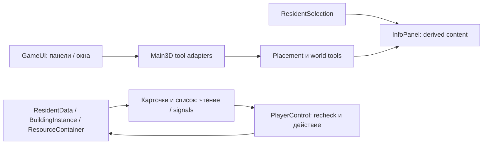

# VillageSim — архитектурный аудит нового UI

> Актуализация 2026-10-14: Legacy 2D удалена отдельным согласованным изменением после E6/P1. Требования сохранения `main.tscn`, legacy startup, standalone cards и старых UI defaults ниже относятся только к историческим этапам и больше не действуют. Поддерживается только `main_3d.tscn`; общие domain API сохранены. История аудита/checkpoints не переписана. Полезные 2D domain fixtures заменены изолированными fixtures без renderer, а presentation assertions проверяют canonical UI.

## 1. Статус, основание и вывод

Последующее обновление: A1–A6 согласованы заданием E1 (уточнение A4 — §6/§15); реализованный E1 — §16, последующий E2 — §17. Факты исходного аудита ниже описывают состояние до внедрения.

Дата: 2026-10-13. Исследованный HEAD: `dc65f4593266fafcf36cfa2fb17a924bae7c127a`, ветка `main`, исходное рабочее дерево чистое. Каноническая сцена — `res://scenes/main_3d.tscn`. Единственный источник требований — [UI_DESIGN.md](UI_DESIGN.md), включая закрытые Q1–Q9. [План внедрения](UI_IMPLEMENTATION_PLAN.md) описывает шесть предлагаемых этапов.

**Новый UI можно внедрить поверх существующей симуляции. Основная работа — композиция, связи с данными и обработка ввода. Переписывание logistics, production, movement или assignment lifecycle не требуется.** Нельзя просто перенести существующие панели под новые контейнеры: Main содержит жёсткие NodePath, карточки самостоятельно show/hide и обновляются в `_process`, а camera pan обходит GUI-перехват через polling.

Ниже разделены проверенные факты, предложения и вопросы согласования. Все новые имена сцен, классов и методов — предложения; они не реализованы. Созданы только два документа. UI_DESIGN и остальные документы, скрипты, сцены, тесты и ресурсы не изменены.

## 2. Исследование и границы доказательств

Прочитаны AGENTS.md и UI_DESIGN целиком; изучены актуальные разделы DECISIONS/GAME_DESIGN/ROADMAP о canonical/legacy, назначениях, construction, portal/COURIER, F10, social/diary и per-resource containers. Код проверен непосредственно, а не только по таблице API спецификации.

Использованы source inspection, существующие Godot tests и отдельная headless-проверка viewport. Запущены десять исходных тестовых скриптов: все exit 0, runtime ERROR/WARNING 0. Новые UI-компоненты, API и тесты не создавались. Исследовательские runner/logs находятся вне Git: `C:/Users/SW/Documents/Codex/outputs/ui-architecture-audit/`.

Это не rendered QA нового UI: его ещё нет. Не запускались full suite, analyzer и import в рамках этого аудита. Ранее известные четыре analyzer warnings не объявляются исправленными. Рассчитанная геометрия требует будущих скриншотов на двух разрешениях.

## 3. Карта существующих компонентов

Ссылки ведут к текущим файлам; номера строк относятся к исследованному HEAD.

| Компонент / точка входа | Ответственность и зависимости | Повторное использование / необходимые изменения | Риск |
|---|---|---|---|
| [main_3d.tscn](../scenes/main_3d.tscn):20,65 | Node root, World Node3D, HUD CanvasLayer, две PackedScene карточки, ResidentSelection | Сохранить World/Camera/Residents; заменить только каноническую HUD-композицию | Ошибка bootstrap либо двойные карточки |
| [main.tscn](../scenes/main.tscn):13,30 | Legacy World Node2D, тот же Main, те же карточки и selection | Сцену не мигрировать; проверить общие скрипты с прежними default bindings | Непреднамеренная параллельная переделка legacy |
| [main.gd](../scripts/main.gd):66,130 | Создание симуляции и runtime HUD, связывание данных; `_ready` вызывает virtual hooks | Малые presentation hooks и canonical overrides; порядок создания систем сохранить | Прямые обращения к удалённым Label/Button |
| [main_3d.gd](../scripts/world_3d/main_3d.gd):43 | Вызывает super, затем areas/list/nav/F10; мир и инструменты | Подключить новый UI к реальным services через ссылки/Callable | Пропуск domain wiring из-за замены super._ready |
| [resident_selection.gd](../scripts/resident_selection.gd) | Один `_selected_entity`, derived resident/building, один selection_changed | Сохранить API без второй selection-модели | Ошибочное clear между прямыми переключениями |
| [resident_card.tscn](../scenes/resident_card.tscn), [resident_card.gd](../scripts/resident_card.gd):44,97,102,153 | Правый PanelContainer; жесткие widget paths, profession/area/assignments через PC; signal-подписки и visible polling | Сохранить специализированный скрипт; добавить явное связывание widgets и embedded presentation; новые canonical layout/tab scenes | Старая карточка show() возвращает скрытые детали; утечки подписок |
| [building_card.tscn](../scenes/building_card.tscn), [building_card.gd](../scripts/building_card.gd):30,42,58,123 | Lifecycle/resources/housing/staff; construction/resource events, polling snapshot; Town management | Сохранить reads/actions; отделить компактный header, вкладки и новый host | Статус BUILT ошибочно считается производством; stale subscription |
| [settlement_residents_panel.gd](../scripts/settlement_residents_panel.gd):7,37,48 | Список имён из PC; refresh на roster; click скрывает окно и выбирает resident | Сохранить источник/selection; изменить UI-структуру и click workflow на таблицу/диалог | Список скрывается или теряется building selection |
| [construction_panel.gd](../scripts/construction_panel.gd):9 | Runtime HBox кнопок, цена в tooltip, отдельное collapse | Заменить canonical вид каталогом; оставить legacy default | Новый вид не должен содержать placement validation |
| [building_placement.gd](../scripts/building_placement.gd):27 | Проверка confirm, ID, registry append, UNDER_CONSTRUCTION, placed/changed; очищает selected_definition | Не менять транзакцию; canonical UI повторно активирует тот же тип после успешного confirm | Двойная стройка, lost rotation, событие меняет контекст |
| [building_placement_3d.gd](../scripts/world_3d/building_placement_3d.gd):11,32 | select сбрасывает rotation; snap, footprint, entrance/runtime blocker checks | Сохранить validate/create; добавить узкий способ восстановить quarter_turns при повторе | Срезанные проверки footprint/entrance |
| [building_ghost_3d.gd](../scripts/world_3d/building_ghost_3d.gd) | Presentation preview из placement; не владеет building | Переиспользовать | Ghost ошибочно считается сущностью |
| [interaction_service.gd](../scripts/interaction_service.gd), [interaction_menu.gd](../scripts/interaction_menu.gd):11,34 | ПКМ actions, options и recheck; меню прячет себя до execute | Сохранить world commands/food/talk; новый assignment dialog не является этим меню | Разные target IDs и два пути исполнения одного клика |
| [prototype_hud.gd](../scripts/prototype_hud.gd) | Collapse старого debug HUD, состояние UI | Оставить для legacy; новый canonical shell не нуждается в его telemetry layout | Название DebugPanel путается с F10 |
| [social_feed.gd](../scripts/social_feed.gd):7,26 | Bottom-left ephemeral text, Timer real time, latest снизу; mouse IGNORE | Перенести canonical anchors и insertion order; источник/lifetime не менять на первом переносе | Изменение генерации/RNG/diary под видом UI |
| [game_time.gd](../scripts/game_time.gd):18,65,73,78 | Monotonic minute clock, pause, speeds, phase signals; календаря нет | Сохранить; UI день derived из total_minutes, HH:MM через get_clock_text | UI action неожиданно меняет time или pause |
| [prototype_camera_3d.gd](../scripts/prototypes/prototype_camera_3d.gd):7,26,35,47 | Polling keyboard; MMB в _input; wheel в _unhandled_input; shared с prototype | Узкие разрешающие predicates для фокуса/мыши; математику движения не менять, default разрешает прежний режим | Поиск двигает камеру; колесо скроллит и zoom одновременно |
| [debug_panel.gd](../scripts/debug_panel.gd):19,110,149 | DeveloperPanel F10 в _input, debug placement и отдельная paused очередь | Сохранить функции/условия debug build; Escape делегировать общему приоритету только в canonical | F10 либо paused spawn перестаёт работать |
| [player_control.gd](../scripts/player_control.gd):89,149,172,199 | Единственный domain admission assignments/housing; derived counts | Использовать действия и error query; возможны малые read-only helpers | UI сначала меняет profession, затем узнаёт отказ capacity |
| [building_use_3d.gd](../scripts/world_3d/building_use_3d.gd):7,55,63 | Реальная marker occupancy, slots_changed/removed, портал | Только читать посетителей; не использовать для staff capacity | Кадровые и physical slots смешаны |

**Совместно используемые части:** Main, ResidentData/PC, карточки PackedScene/scripts, Selection, ConstructionPanel и базовый placement, SocialFeed, InteractionMenu/Service, GameTime. Их изменение может затронуть legacy. Только Main3D содержит road/area/developer integration и Raycast3D. Camera3D также используется отдельным prototype; Camera2D имеет другой controller.

### 3.1. Bootstrap, который нельзя потерять

Main._ready сначала bind_selection по `$HUD/ResidentCard`/BuildingCard, затем создаёт здания и жителей, PC/setup/bind_control, social, Feed, HUD и interactions; дальше resources/logistics/clock и construction. Main3D._ready готовит world adapters до super, после него подключает areas/list/forest/rocks/roads/F10. Новый UI должен вписаться в этот порядок, не создавать стартовые domain entities повторно.

Удаление только `_build_hud()` недостаточно. `_update_food`, `_update_pause`, `_update_clock`, `_update_phase`, `_update_production`, `_update_warehouse_food` и `register_spawned_resident` обращаются к Label/Button. Последний пишет population_label напрямую. `_update_logistics` форматирует список jobs; новый UI не должен оставлять этот тяжёлый невидимый refresh каждое событие ради compatibility.

### 3.2. Существующие отличия от требований

- Карточки сами скрываются без selection; отдельной day-card нет. Их Close очищает selection, а не просто сворачивает.
- ResidentCard._refresh_relationships показывает весь roster с `get_opinion`, включая отсутствующие records. Новая вкладка должна читать existing relationships/has_relationship; neutral read не создаёт запись, но не доказывает «известное отношение».
- Дневник отображает все сохранённые записи; первая UI-версия фильтрует текущий день без mutation истории.
- BuildingCard работает каждый frame, хотя часть полей event-driven. Recipe production_progress не имеет отдельного changed; minute refresh должен быть после domain listeners.
- Construction выбор не очищает selection, confirm одноразовый, select() сбрасывает quarter_turns. Это согласованные будущие UX-изменения, не обнаруженные gameplay-баги.
- Settlement panel скрывается после строки; профессии и workplace не обновляются отдельными row events.
- F10 Esc в `_input` при active debug placement способен сработать раньше нового обычного окна. Нужна координация, а не зависимость от порядка nodes.
- InteractionMenu outside-click только hide, без consume. При миграции проверить, должен ли dismissal click оставаться прежним world action; не менять этот контракт молча.
- Отдельное статическое замечание вне UI scope: Main._unhandled_key_input, ветка Shift+8, обращается к `kitchen_data.resources` без null guard, хотя canonical стартует без Kitchen. Legacy hotkey fixtures имеют кухню. Возможный SCRIPT ERROR при таком debug shortcut требует отдельного bugfix/проверки; аудит не исправляет и не заявляет runtime-воспроизведение этого случая.

## 4. Предлагаемая структура Godot

Предложение для согласования: один authored `scenes/ui/game_ui.tscn` внутри существующего HUD. UI root — Control Full Rect, `mouse_filter=IGNORE` вне панелей; не полноэкранный STOP-щит. UI работает на pause (PROCESS_MODE_ALWAYS); World продолжает действующие правила.

```text
Main (Main3D; прежние services и tools)
├─ World / Camera3D / views                 без переноса в UI
├─ ResidentSelection                       существующий, один
└─ HUD: CanvasLayer
   ├─ GameUI: Control Full Rect
   │  ├─ MessagesAnchor → SocialFeed
   │  ├─ TimeAnchor → TimeControls
   │  ├─ ActionsAnchor → ActionPanel
   │  ├─ InfoAnchor → InfoPanel
   │  │  ├─ DaySummary
   │  │  ├─ ResidentCard (специализированный)
   │  │  ├─ BuildingCard (специализированный)
   │  │  └─ BuildingTypePreview
   │  └─ Windows: Control Full Rect
   │     ├─ обычное окно ResidentsWindow
   │     └─ верхний AssignmentDialog
   ├─ InteractionMenu                      существующий ПКМ UX
   ├─ DeveloperPanel                       F10, отдельный developer слой
   └─ подтверждение WorkArea / debug toggle сохранить доступность
```

Это схема, не созданная сцена. Не нужны Autoload UI-manager, SubViewport для игры, копия residents/buildings или plugin framework. Будущий fullscreen использует отдельный slot/host слоя окон только когда появится настоящая функция; пустую fullscreen scene сейчас не создавать.

MarginContainer задаёт отступы; VBox/HBox и TabContainer — внутреннюю структуру; ScrollContainer/ItemList либо Tree — длинные списки. Corner anchor wrappers располагаются по Full Rect canvas, а не внутри единого HBox, который уменьшал бы world viewport. Container владеет размерами своих детей: anchors используются на внешних wrappers, не одновременно с ручным размещением управляемых им children.

### 4.1. Минимальная интеграция с Main/legacy

Рекомендуется добавить в Main два малых presentation getter hooks (`resident_card_view`, `building_card_view`, окончательные имена при реализации). Default возвращает прежние `$HUD/…`; Main3D override возвращает соответствующие компоненты нового InfoPanel. Так меняются binding points, а не domain startup.

Main3D._build_hud override связывает реальные widgets нового TimeControls с текущими clock/pause/speed callbacks. Население связывается с реальным заголовком списка/его краткой строкой. Canonical overrides старых telemetry refresh только обновляют нужные UI dirty flags либо ничего не делают, если поле исключено из нового UI. В legacy старые handlers остаются. Новый GameUI уже находится в сцене и готовит widgets до Main._ready; после super injection/services выполняется единичный initial refresh. Не оставлять invisible fake Labels только чтобы избежать null.

Первый этап сохраняет существующие карточки как переходные реально работающие компоненты; второй вводит их новый embedded layout. Не пропускать super._ready, не переносить resource callbacks в UI как владельца производства. `$HUD/ResidentCard` в canonical tests придётся заменить на новый getter/путь; legacy tests остаются с исходными сценами.

## 5. Состояния и переходы

| Состояние | Владелец | Данные / ограничения |
|---|---|---|
| Выбранный объект | ResidentSelection | Только existing RefCounted entity; UI не копирует selected ID как вторую истину |
| Green | ActionPanel | active_section_id или пусто, expanded; описания разделов |
| Blue | InfoPanel | expanded, active_tab_id; тип content вычисляется из selection и placement |
| Обычное окно | UI root/window coordinator | Одно open_window_id; поисковые/scroll prefs внутри настоящего окна |
| Диалог | Window coordinator + dialog | resident_id, captured building identity/ID, action options для текущего контекста; не новый selection |
| World tool | Main3D + placement/road/area/DeveloperPanel | Эти существующие states authoritative; UI читает tool summary, не содержит второй mutable tool enum |
| История, stocks, tasks | Существующие domain/runtime owners | Ни один из этих данных не является UI state |

Один локальный GameUI coordinator управляет только панели/окна и обращается к tool Callables Main3D. Отдельный большой universal manager не нужен. Tool summary вычисляется по existing active()/is_active() и `road_tool.active`; диагностический assert «не более одного» допустим в будущих тестах, не новый scheduler.



| Событие | Предлагаемый переход |
|---|---|
| Прямой resident↔resident/building selection | Сохранить expanded, оставить доступный tab либо выбрать Bio/Info; не вызывать clear посредине |
| Selection.clear без type preview | Day, compact, tab fallback; следующий entity compact |
| Выбор building tile | Cancel другие tools → selection.clear → placement.select → type preview; coalesced UI refresh не показывает промежуточный Day как отдельное действие |
| Confirm success | Создать через прежний confirm, повторно активировать captured definition/orientation; type preview продолжается |
| Collapse construction | Cancel building placement, сбросить preview в Day; закрыть только green content, не обычное окно |
| Open/toggle quick window | Открыть/закрыть/заменить одно окно; остальные panel prefs неизменны |
| Row при building selection | Открыть AssignmentDialog, не выбирать resident |
| Row без building selection | selection.select(real resident); окно остаётся независимым |
| Успешный assign/home | Dialog close, список/персонал dirty; тот же building selection |
| Контекст изменился при открытом dialog | Предлагается закрыть stale dialog, оставить ResidentsWindow и новое selection; следующий row создаёт новый captured context. Не переназначать незаметно |
| Context объект удалён | Безопасно закрыть dialog/перечитать карточку; никаких восстановлений удалённой entity |

Последняя политика stale dialog — предложение A2 для согласования, не новое уже утверждённое требование. Fullscreen в будущем скрывает UI hosts и сохраняет panel/window prefs; при возврате перечитывает живое selection, не восстанавливает его из собственного снимка.

## 6. Расширяемая зелёная панель и строительный каталог

Простая ordered Array описаний с `id`, `kind` (TAB/QUICK_WINDOW), `label`, `content`/Callable, optional icon и available. Регистрация нескольких секций в GameUI.setup; не Autoload/plugin loader. TAB кнопки имеют отличимое состояние активной вкладки, QUICK — отдельное оформление; кнопки не генерируются из всех будущих design headings.

Первая версия: строительная вкладка, «Жители», существующий доступ к Dirt Road. A4 согласован: в единой вкладке «Строительство» четыре расширяемые категории — «Производство» (хижина лесоруба, каменоломня, хижина собирателя, лесопилка), «Логистика» (склад), «Поселение» (дом, кухня), «Объекты» (существующая грунтовая дорога). Это категории каталога, а не четыре кнопки основного меню. Объекты используют собственные placement adapters при необходимости. Каталог реализуется в E3; E1 сохраняет текущий ряд реально работающих инструментов. «Журнал», «Экономика», «Квесты» не регистрируются. Длинный нижний ряд: предлагается горизонтальный ScrollContainer; плитки — GridContainer внутри вертикального ScrollContainer.

Каталог использует настоящие BuildingDefinition (семь player_buildable типов). Отдельное небольшое UI-описание по definition.id может хранить image/description/category, **без копии recipes, footprints или limits**. Новые цены читать из construction_requirements; размер — footprint_cells×BuildGrid.CELL_SIZE с quarter_turns, а не definition.size. Нет новых ассетов в аудите; изображения/стиль будут отдельной частью утверждённого UI-этапа, без «будущих зданий».

Предлагаемая минимальная последовательность в canonical confirm adapter:

1. Перед confirm захватить definition, quarter_turns и generation инструмента.
2. Вызвать существующий placement.confirm ровно один раз; invalid остаётся прежним отказом.
3. Только если получен BuildingInstance и инструмент не отменён/сменён reentrant callback — повторно активировать тот же тип и восстановить orientation через небольшой 3D placement setter, resnap и changed.
4. Не подтверждать вторую стройку этим же событием и не вызывать select(), который незаметно обнулит rotation.

Существующий `BuildingPlacement.confirm` и legacy одноразовый контракт остаются default. Альтернатива — optional continuous flag в базовом placement, но она затрагивает shared model больше; рекомендуется adapter A3. При любом варианте прежние `_create_instance`, `_show_building`, `_activate_completed_building`, BuildGrid occupy, Navigation blocker, entrance/runtime checks и resource lifecycle не обходятся. Нехватка stock не становится новым placement gate.

Все tool start/cancel проходят один набор Main3D presentation entry points, вызывающий существующие cancellation methods и очистку pending click/road events. Так green/blue/catalog не дублируют проверки инструментов. При переключении modes инкрементировать локальную input generation и отбрасывать queued events прошлого инструмента; не привязывать commands к rendered-frame таймеру.

## 7. Синяя панель и специализированные карточки

Общий InfoPanel владеет frame/header, кнопкой раскрытия, tab host и Day/TypePreview. Карточки продолжают отвечать за resident/building reads и делегирование действий. Новые canonical detail scenes не копируют domain setters; их UI-код связывается с существующими scripts через явные widget references в одном `bind_widgets`/view-mode hook, без поиска по произвольным mesh/node names.

В shared scripts предлагается embedded mode: нет собственных corner offsets и самовольного show/hide выбранной вкладки. Default legacy mode использует прежние paths/behavior. При переразметке надо заменить как @onready paths, так и `$Margin/…` внутри методов, динамически создающих controls/scroll/list. Простое reparent старых labels после _ready небезопасно. Переиспользуются форматирование навыков/traits, API действий, subscription logic; новые UI-вкладки, foldouts и clickable names действительно необходимы, их пока нет.

В compact показаны обязательные текущие поля; HP отсутствует. Для expanded resident: Bio/Work/Relationships, diary и skills foldouts. В Building Info показываются именные списки production/Porter, housing и реальные visitors; Production/Storage доступны по capabilities/lifecycle. Construction отображается в Info/отдельном строительном содержимом без production/storage tabs. Точный label строительной вкладки можно оставить Info, чтобы не создавать новый неутверждённый набор; это предложение.

«Демонтировать» — disabled Button с текстом во вкладке Info, без pressed callback и ConfirmationDialog. Никаких Main3D.cancel_construction/Logistics.remove_building. При исчезновении объекта используются уже existing lifecycle notifications; кнопка удаления не является их источником.

На имена worker/resident/relationship привязывать stable ID, разрешать через PC перед select. Для отношений использовать только existing records, включая сохранённый neutral record; не запускать set_opinion/get_or_create. Для diary фильтр дня derived от GameTime.total_minutes, без удаления KEY/history или изменения TEMPORARY expiration.

## 8. Окно жителей, роли и housing

Рекомендуется Control/PanelContainer + Tree с тремя колонками, metadata resident ID и custom sorting/search controls; встроенного «worker-picker mode» нет. Возраст доступен для сортировки, не обязательная четвёртая колонка. Допустим VBox rows при 100 жителей, но Tree проще сохраняет scroll/row identity; сравнение — предмет A1/layout approval, не новая система населения.

Реестр — PC.get_residents; filtered/sorted IDs — только ephemeral UI projection. WorkArea считается назначением. «Без места» не означает NONE, IDLE или unemployed gameplay status: Builder/world-work и unassigned Porter читаются честно. Сортировка равных ключей stable resident ID. Рoster меняет набор rows; assignment event обновляет строку и coalesced filter/sort. Заполненность target не отфильтровывает строку.

### 8.1. Точные API границы

| Потребность | Уже есть | Предлагаемая добавка / решение |
|---|---|---|
| Список и resolution | PC.get_residents/get_resident/get_building | Использовать; не второй registry |
| Роли здания | definition.worker_profession, porter_capacity | Узкий `get_workplace_roles(id)` читает их даже для UC, чтобы применимая роль имела disabled «ещё строится»; не `_workplace_professions` как staff list |
| Target availability | workplace_assignment_error / can_assign_workplace | Использовать для enablement, execute повторяет assign_workplace explicit role |
| Пригодность к роли в принципе | Нет отдельного query | `profession_eligibility_error(resident_id, profession)` или bool wrapper: registered resident + valid existing profession, без capacity/поиска workplace и новых квалификаций |
| Отдельные counts/free | get_production_workers, get_porters, get_staff_capacity/get_free_staff_places | Existing queries; production unlimited=-1 показывать словом, Porter0 — запрет |
| Housing | is_housing_target/get_home/get_home_occupants/assign_home/clear_home | Небольшой read-only `home_assignment_error` для readable refusal с теми же checks; setter remains final guard |
| Профессия/область/снятие | assign_profession/assign_work_area/clear_work_assignment | Не мутировать ResidentData из UI |
| Task / commands | current_intent, describe_assignment, add/cancel_assignment, runtime.commands | Existing typed presentation; UI не вызывает has_work/best_task для объяснения idle |

Q3 query должен выражать **«профессия допустима для зарегистрированного жителя вообще»**, а не «assign_profession сейчас найдёт workplace». В текущем коде нет age/skill restrictions; фильтр не вводит их. Actual assign_profession для Gatherer/Sawyer по-прежнему может отказать без здания; Lumberjack/Miner/Porter могут быть unassigned. Новые read queries согласовать (A5), предпочтительно сосредоточить в PlayerControl с переиспользованием existing simple predicates; не складывать повторную domain validation в window script.

### 8.2. Диалог и транзакция действия

При row click captured resident ID и текущий building object/ID служат параметрами диалога, не выделением. Варианты из applicable roles; disabled reason виден без tooltip. HOME добавляет housing action, не profession. Уже назначенная роль — видимое недоступное действие «Уже работает здесь», несмотря на идемпотентный bool PC.can_assign.

Перед pressed action: разрешить IDs → убедиться в registration identity и неизменном выбранном building/context → получить текущую причину → вызвать **один** assign_workplace(..., explicit role) либо assign_home. Не вызывать assign_profession сначала: auto-pick может выбрать другое здание и повредить старое назначение перед target refusal. После callback перечитать живые данные; успех закрывает dialog, не ResidentsWindow/Blue. Отказ показывает нынешнюю причину и сохраняет прежнее состояние через действующий domain API.

Настройка фильтра из кнопки «назначить production/Porter» — same window parameters, не второй window instance. После смены selection на карте будущие row actions используют новый building. Предлагаемый stale dialog close из §5 обеспечивает, что старое нажатие не превращается в назначение в новую цель.

## 9. Ввод: факты и предлагаемое распределение

Godot передаёт события через `_input`, GUI, shortcut/key-unhandled и `_unhandled_input`; consume останавливает дальнейшую передачу, поэтому world actions лучше оставлять после GUI. См. [официальный порядок InputEvent](https://docs.godotengine.org/en/stable/tutorials/inputs/inputevent.html). Это не решает polling автоматически: Camera3D._process читает Input независимо от GUI.

| Событие | Текущее место | Предлагаемое правило |
|---|---|---|
| Esc | Main3D._unhandled_input; F10 _input раньше GUI | Один canonical handler/coordinator: верхний dialog/context → ordinary window → existing tool cancellation; echo игнорируется, handled после одного действия |
| LMB/RMB GUI | Control._gui_input / buttons | STOP на реальных panel/window rects, accept_event для действий; прозрачный Full Rect IGNORE |
| LMB/RMB мира | Main3D очередь _clicks → physics raycast | Один world executor, tool generation + revalidation; не дублировать _gui_input raycast |
| Road release/UI gap | Main3D._input наблюдает, не создаёт road cells | Сохранить наблюдение release/end_stroke даже когда GUI consume; очередь не интерполирует через UI |
| Wheel UI | ScrollContainer/Tree/ancestors | UI scroll потребляет wheel даже на пределе списка; камера zoom только вне UI |
| Keyboard search | Focused LineEdit + Main inherited hotkeys + Camera polling | Text-focus predicate блокирует gameplay hotkeys и polling pan, не симуляцию; Esc обработать по общему правилу |
| MMB | Camera._input grab-map | Сохранить над обычными панелями, если они не используют свой MMB drag; release/focus-out всегда завершает pan; без world actions |
| F10 | DeveloperPanel._input, OS.is_debug_build | Клавиша остаётся единственным normal shortcut; без основной UI-кнопки; developer actions unchanged |
| Enter WorkArea | Main3D._unhandled_input | Не подтверждать область из LineEdit/dialog; input gate до tool dispatch |

На panel boundary проверить `mouse_force_pass_scroll_events`: у Control default true; один STOP без анализа wheel propagation недостаточен. Внешние UI boundary принимают wheel, внутренний ScrollContainer сначала прокручивает. Свойства описаны в [Control reference](https://docs.godotengine.org/en/stable/classes/class_control.html#class-control-property-mouse-force-pass-scroll-events).

Рекомендуется маленький `ui_input_context` при GameUI с predicates `is_text_editing`, `has_top_dialog`, `blocks_world_pointer`, `consume_escape`. Это только permissions presentation input. Main3D и camera читают его, default без GameUI сохраняет старое управление. Не переводить все controls на новую InputMap и не создавать event bus всех gameplay actions.

Особенно важно: перенос Esc в новый child._input не гарантирует приоритет над DeveloperPanel._input из-за обхода дерева. F10-panel Escape должен делегировать canonical hook; standalone/default behavior сохранён. Общий handler закрывает upper dialog/window, только потом вызывает tool cancel. Plain F10 open не считается quick window автоматически — варианты A6 ниже. Существующий NPC command/critical/cleanup timing не проходит через UI coordinator.

Outside-click InteractionMenu и открытый assignment dialog требуют согласованной политики A2/A6. Предлагается UI close/cancel click поглощать, не переиспользовать его как MOVE_TO/selection/placement; это отличие от текущего outside-dismiss и не применяется без approval.

## 10. Актуализация данных и стоимость UI

| Сведения | Existing event / read | Предлагаемый refresh |
|---|---|---|
| Selection | selection_changed | Disconnect old entity, bind new, one initial refresh; panel expanded отдельно |
| Needs | Need.changed для четырёх needs; HUNGER/FATIGUE compatibility signals | Менять соответствующую строку выбранного resident; не весь roster |
| Activity | ResidentData.activity_changed | Compact summary/task label |
| Profession/workplace | PC.profession_changed/work_assignment_changed; work_areas.changed | Row by ID, selected card, selected building staffing; coalesce duplicate signals одного _assign |
| Roster | PC.residents_changed, resident_unregistered | Add/remove rows; stable sort/filter once; не scan world nodes |
| Mood/name/age | Поля, без dedicated change signals | Контролируемый visible poll, предложение 0.2 real seconds; никакого full rebuild |
| Skills/traits/preferences/relations | skill_changed, traits_changed, trait_preferences_changed, relationship_changed | Existing connections; relationships own sparse records, callbacks disconnect при смене/exit |
| Diary | diary_changed + minute_changed для нового дня | Filter текущего дня, rebuild только diary section на событии |
| Home | PC.home_changed | Обновить personal home и affected building occupants; assignments не смешивать |
| Stocks | ResourceContainer.changed; capacity setter без dedicated capacity event | Строка resource; capacity initial/context refresh + bounded visible fallback |
| Construction | BuildingInstance.construction_changed | Read actual materials/progress/lifecycle, tabs dirty; coalesce reentrant events |
| Gatherer production | GathererProduction.changed | Selected building progress; no new recipe accounting |
| Recipe progress | production_progress без отдельного сигнала; clock.minute_changed | call_deferred/coalesced read после domain minute listeners; no per-frame rebuild |
| Visitors | BuildingUse3D.slots_changed/removed, existing marker references | Только выбранный building; occupants не хранить как второй list |
| Current work / haul | current_intent + runtime intents signals, Logistics.changed; некоторые fields silent | Selected detail read; bounded visible fallback; никаких has_work/path searches ради labels |
| Clock/speed/pause | minute_changed/speed_changed; toggle_pause без pause signal | TimeControls route pause через existing Main/clock; read tree.paused также после F10, bounded poll |

0.2 seconds — предлагаемый UI cadence, не изменение GameTime и не игровой баланс. Таймер может работать на pause для UI management; время симуляции не продвигается. Обновления minute coalesce в один deferred paint, не на каждый игровой minute при debug jump/x20. Список rebuild разрешён при смене roster/search/sort; на amount/needs событии его не пересоздавать. Закрытые окна не выполняют периодические scans.

Subscriptions принадлежат компоненту/видимому объекту и явно отключаются при rebinding/_exit_tree. RefCounted owners не должны удерживать освобождённый UI через callbacks. Никаких глобальных долговечных caches occupancy, capacity, source availability или route reachability. UI snapshots служат только сравнению текста и не участвуют в выборе gameplay actions.

## 11. Лента, время и отложенные функции

Первый перенос Feed: те же feed_message→add_message, те же сообщения/Timer/limit, новый top-left anchor и вставка нового Label первой строкой. Не менять successful event generation/diary/RNG. Current mouse IGNORE допустим для декоративной ленты без действий; если добавляются интерактивные links, это последующая функция с proper input boundary. Общие уведомления без источника не изобретаются.

TimeControls: GameTime.get_clock_text, total_minutes для игрового дня, SUPPORTED_SPEEDS [1,2,4,10,20], toggle_pause/set_speed. Pause icon/read обновляется и после F10; новый pause signal не обязателен. Debug telemetry не переносится в этот блок.

Journal/unread, event identity/object links и retention общего журнала — отдельный будущий проект. Первое меню не имеет «Журнал» и счётчика-фикции. Personal diary используется сейчас. Demolition/HP/семья/production policy controls также вне первой версии; только disabled demolition Button — прямо разрешённое исключение.

## 12. Предварительная геометрия — предложение для согласования

### 12.1. Проверенный canvas scale

`project.godot` имеет viewport_height=720, canvas_items, aspect=expand. Headless-проверка настоящей main_3d после двух process frames установила:

| Window | content_scale_size | UI visible rect | stretch transform | Camera3D.size |
|---|---|---|---:|---:|
| 1920×1080 | 1152×720 | 1280×720 | 1.5 | 44 |
| 1600×900 | 1152×720 | 1280×720 | 1.25 | 44 |

Это измерение координат, не скриншот макета. Godot различает canvas base size и window pixels при canvas_items; anchors/containers относятся к canvas. См. [Multiple resolutions](https://docs.godotengine.org/en/stable/tutorials/rendering/multiple_resolutions.html). Рекомендуется сохранить эти settings: задавать размеры UI в логических units, а таблицу экранных pixels считать после stretch. Не хардкодить 1920 в Control.position.

### 12.2. Первоначальная таблица рамок (историческое предложение до E1)

Таблица и последующие расчёты в §12.2–12.3 сохраняют историю исходного предложения, а не действующий post-E5 layout. Актуальные правила заменены согласованными UI Polish revisions в UI_DESIGN §11.1.

Отступ 12 logical units. Размеры ordinary window фиксированы относительно состояния синей панели. Все значения ниже предварительные, без реализации; запись — `(x,y,w,h)`.

| Область | Logical 1280×720 | Pixels 1920×1080 | Pixels 1600×900 |
|---|---|---|---|
| Feed | (12,12,400,120) | (18,18,600,180) | (15,15,500,150) |
| Time | (968,12,300,56) | (1452,18,450,84) | (1210,15,375,70) |
| Green раскрыта | (12,508,720,200) | (18,762,1080,300) | (15,635,900,250) |
| Green row | (12,664,720,44) | (18,996,1080,66) | (15,830,900,55) |
| Blue Day | (948,656,320,52) | (1422,984,480,78) | (1185,820,400,65) |
| Blue compact | (948,556,320,152) | (1422,834,480,228) | (1185,695,400,190) |
| Blue expanded | (948,140,320,568) | (1422,210,480,852) | (1185,175,400,710) |
| ResidentsWindow | (134,160,680,400) | (201,240,1020,600) | (167.5,200,850,500) |
| AssignmentDialog | (254,250,440,220) | (381,375,660,330) | (317.5,312.5,550,275) |

ResidentsWindow центрируется в левой безопасной полосе: width доступной полосы=`W−blue_width−3×margin`; `x=margin+(полоса−window_width)/2`, `y=(H−window_height)/2`. Изменение expanded не меняет эти выражения. При двух размерах правый край window=814 logical, левый край blue=948, зазор 134. Dialog центрируется внутри ResidentsWindow, тоже не пересекает blue. Time нижний край=68, expanded blue верхний=140. Green не перекрывает blue.

ResidentsWindow может закрывать часть раскрытого green content, но его нижний ряд остаётся доступен; это не запрещено спецификацией. Если такое перекрытие нежелательно, необходимо другое согласование размеров/высоты green, а не сдвиг камеры. Header/footer/dialog roles имеют bounded heights и прокрутку содержимого; длинное имя переносится, а не расширяет окно. Для нескольких применимых ролей dialog body scroll, внешняя рамка фиксирована.

### 12.3. Минимум и недостаточная ширина

Предлагаемый разумный физический минимум — **1440×900** при UI scale 1.25, логический canvas минимум 1152×720. На этом canvas blue left=820, window x=70/right=750, gap70; green width720 помещается. Это арифметическая оценка, не подтверждение читаемости шрифта. Обязательные supported checks остаются 1920×1080 и 1600×900.

Предлагается ограничить desktop window.min_size после approval, чтобы UI не приходилось перекрывать blue или уменьшать ordinary window при её раскрытии. Ниже минимума возможны: предупреждение о неподдерживаемом размере либо отдельный compact layout/scale profile; второй вариант — отдельное согласование, не часть первой версии. Canvas stretch уже уменьшает текст на маленьких физических окнах; его наличие не означает приемлемую читаемость. Не добавлять camera zoom для компенсации UI.

Рендер должен дополнительно фиксировать window size, logical viewport, stretch scale и реальные get_global_rect; screenshot «1920×1080» без этих данных недостаточен. Проверить DPI/OS scale и внешнее окно, не только editor embed.

## 13. Стратегия тестов и проверенные baseline

Проект использует `tests/test_*.gd extends SceneTree`, check/failures, push_error и quit(0/1). Существуют production integration fixtures, `root.push_input` для настоящего GUI/world input и отдельные render flags/captures (`test_debug_panel`, `test_resource_handling`, `test_porter_workplace_3d`). Ни framework, ни snapshot approval system вводить не нужно.

| Запущенный исходный script | Результат |
|---|---|
| test_ui_cleanup | 19 checks / 0 failures |
| test_resident_selection | PASS (не печатает numeric count) |
| test_building_selection | 31 / 0 |
| test_camera_drag | 57 / 0 |
| test_debug_panel | 31 / 0 |
| test_construction_3d | 80 / 0 |
| test_porter_staffing | 120 / 0 |
| test_porter_workplace_3d | 141 / 0 |
| test_housing | 64 / 0 |
| test_social_event_feed | 258 / 0 |

Итого 10/10 scripts exit0, 801 numbered checks плюс selection PASS. `baseline/checks.json` содержит реальные codes, timings и issues; viewport-result.json exit0, issues[]. Headless baseline намеренно проверяет старые behaviors, включая одноразовый placement и прежнее скрытие жителей; он не подтверждает новые требования. UI-specific expected assertions меняются только вместе с утверждённой реализацией, domain invariants не ослабляются.

Будущие тесты: pure UI transitions без fake domain assignment; real canonical interaction через push_input; no second selection; stale dialog/capacity; multi-role/UC/housing; repeat confirm/R/collapse; changed generation drops stale clicks; typed search не двигает camera; actual wheel over table boundary; Esc stack и F10 paused placement. Новый full suite запускается после каждого functional phase вместе с targeted suites.

Rendered QA требует screenshots обеих resolutions для Day/compact/expanded всех типов, residents+expanded blue, dialog с full capacity, construction catalog/rotated ghost и F10. Автоматические rectangles проверяют bounds/intersections, но не читаемость текста, цвет, tiles, переносы или доступность маленьких кнопок. Воспроизвести реальные WORK/haul/build/food, не считать fake labels gameplay proof. Полная matrix этапов — в плане.

## 14. Таблица рисков

Оценки вероятности качественные, по code coupling; это не измеренные проценты.

| Риск | Причина | Вероятность | Последствие | Предотвращение | Проверка |
|---|---|---|---|---|---|
| Selection сломан | Clear между switches, карточки сохраняют свой selected ID | Высокая | Неверные details/outline, сброс раскрытия | Только ResidentSelection, direct select, derived Blue | resident↔building + no camera movement |
| Дублирующее состояние | Staff/occupants/active tool скопированы в UI | Средняя | Stale assignment и доступность | Queries, IDs для UI projection, existing tool states | Move/assign/release + source identity checks |
| Случайная роль | Два аргумента assign_workplace на producer | Высокая | Porter стал Sawyer | Explicit profession per button | Sawmill Sawyer/Porter, none других roles |
| Старое место потеряно | assign_profession перед target capacity | Средняя | Потеря назначения при отказе | Один target API, recheck, no mutate-and-rollback | full workplace сохраняет profession/area/place |
| Committed haul прерван | UI делает forced command при employment | Средняя | Cargo drop/loss, неверный next job | PC assignment only | Existing 3D haul stages + reassign UI |
| Construction данные расходятся | Дублирующий recipe/grid в catalog | Средняя | Неверная стоимость/ID/rotation | Definition reads + existing confirm | real UC, materials, build/nav occupied cells |
| Completion tabs stale | UI смотрит только resources или меняет entity | Средняя | UC показывает производство, двойные workers | construction_changed + same entity, deferred refresh | last minute → BUILT/card tabs |
| Subscription leak | Старые residents/RefCounted callbacks удержаны | Высокая | Повторные updates/stale targets | Owner-scoped connect/disconnect, exit cleanup | 100 switches/free/rebind, orphan warnings |
| UI вызывает pathfinding | has_work/best_task используется как idle label | Средняя | Фризы при открытии/сортировке | Existing execution snapshots, no availability probe | instrument call counts unchanged от UI refresh |
| Per-frame workload | Rebuild Tree/list/relationships каждый frame | Высокая | Дополнительные stalls x20 | Dirty/coalesce, selected-only, closed windows idle | 30/100 residents, x1/x20, node-count/counters |
| Click-through | FullRect IGNORE на active controls, старый buffered click | Высокая | Selection+placement+MOVE_TO одним click | Panel boundaries + generation + one execution | real press/release, world counters неизменны |
| Esc double action | Несколько _input/_unhandled handlers, F10 раньше GUI | Высокая | Dialog/window/tool/selection сброшены вместе | One Escape routing with developer delegation | трехуровневый stack successive Esc |
| Search/pan | Camera polls Input; focus не учитывается | Высокая | WASD/стрелки двигают мир при typing | Text-focus predicate, no movement math changes | Actual focused LineEdit + transforms |
| Wheel conflict | force-pass scroll, unhandled zoom | Средняя | Table scroll+camera zoom | Explicit UI scroll boundary | wheel middle/end/top list |
| Window overlap | Physical/logical size перепутаны | Высокая | Residents закрывают blue | Existing stretch + safe-area formula | two renders/rects + min proposal |
| F10 regression | Полностью перехвачен _input либо paused queue удалена | Высокая | Debug spawn/time controls не работают | F10 remains, route only competing Escape | test_debug_panel/time + paused rendered spawn |
| Legacy regression | Shared scripts/scene paths без defaults | Высокая | main.tscn tests/startup сломаны | Defaults/hooks; legacy scene not remapped | direct legacy + old card/selection tests |
| Недостоверное поле | Новые generic idle/HP/events для заполнения | Средняя | Ложный gameplay state | Q9 hide, no domain placeholder | HP absent, neutral records absent, diary retention unchanged |

## 15. Решения для согласования и альтернативы

Q1–Q9 не открываются повторно. Требуют рассмотрения **предложения реализации**, а не игровой политики:

| ID | Рекомендация | Альтернатива / компромисс |
|---|---|---|
| A1 — композиция и legacy | Authored GameUI + существующие специализированные card scripts с widgets/embedded hooks; default legacy unchanged | Новые независимые card scripts проще initially, но дублируют formatting/actions/subscriptions. Общий presenter hierarchy сложнее необходимого |
| A2 — stale dialogs | При смене/удалении selected building закрывать старый dialog, список сохранять | Перепривязывать открытый dialog к новой цели экономит click, но риск незаметного assignment. Modal block всей карты мешает непрерывному map selection |
| A3 — repeat placement | Canonical adapter captures context и повторно активирует через существующий confirm; узкий rotation setter | Optional continuous flag в shared placement проще event chain, но увеличивает shared model scope и legacy surface |
| A4 — layout/catalog | Согласовано: геометрия §12 с сохранением stretch; четыре категории внутри «Строительства»: Производство / Логистика / Поселение / Объекты. Dirt Road входит в Объекты; каталог только в E3 | Объекты могут использовать разные placement adapters. Финальное оформление E5; fixed screen pixels требуют иной scale policy |
| A5 — queries | Малые PC role/eligibility/housing error reads, no changes to assignment rules | Всё вычислять в UI — меньше domain files, но дублирует checks/разъезжается с setter; использовать mutation недопустимо |
| A6 — input policies | Modeless bounded assignment dialog, stale close; consume dismiss click; F10 не quick window, Escape делегирует общему stack | F10 как обычное окно закроет Residents автоматически — это новый UX, спецификация его не требует. Exact outside-dismiss legacy behavior можно сохранить, но отдельно покрыть |

Новая возможная неоднозначность: активный building placement и допускаемый выбор объекта на карте взаимно исключаются текущим input. Требования не требуют одновременного выбора resident при placement; предложено сохранить исключительность и сначала выйти из tool. Не расширять game selection rules для обхода этого ограничения.

A1–A3 и A5–A6 согласованы пользователем; A4 уточнён выше. Разрешён только E1 отдельным заданием. Согласование архитектуры не разрешает автоматически начинать E2–E6. Полноценная схема минимальных файлов, checkpoints и приёмка каждого этапа — [UI_IMPLEMENTATION_PLAN.md](UI_IMPLEMENTATION_PLAN.md).

## 16. Реализованная основа E1

Канонический HUD содержит `GameUI` с четырьмя corner hosts и `Windows`. Реальные старые карточки находятся в InfoAnchor, без дублирования selection. В ActionsAnchor смонтирован существующий ConstructionPanel с горизонтальной прокруткой и кнопкой существующего списка жителей. Это переходная компоновка: длинные старые карточки, одноразовый placement и прежний список остаются до E2–E4. Новых вкладок, каталога, day-card и диалога назначения ещё нет.

Main предоставляет card getters и presentation hooks; legacy defaults сохранены. Main3D связывает реальные TimeControls с GameTime, перемещает существующий SocialFeed без изменения generation/lifetime/order. Удалённая каноническая telemetry не получает фиктивных Labels и не форматирует logistics summaries. Domain callbacks и порядок bootstrap сохранены.

GameUI координирует реально зарегистрированные окна и верхний Control/dialog, Esc и контекстное меню. Панель строительства остаётся владельцем своего collapsed state; GameUI читает и изменяет его через адаптер. Selection и active tools читаются из существующих систем. `UIInputContext` хранит слабую ссылку на shell и отвечает на focus/pointer queries. Main3D, Camera3D и F10 используют его; default null сохраняет legacy/prototype behavior. Прозрачные hosts не блокируют пустой экран; границы видимых реальных компонентов блокируют press/release/wheel. Road release и разрыв stroke при проходе над UI наблюдаются до GUI consumption.

MMB сохраняет grab-map pan, включая текущие UI-области без собственного drag. F10 остаётся отдельной developer panel; его Esc делегирует тому же stack. Закрытие world context menu внешним ЛКМ/ПКМ потребляет dismiss click только в canonical presentation. Text focus блокирует hotkeys и camera keyboard polling; математическая модель pan/zoom не меняется.

## 17. Реализованная синяя панель E2

InfoPanel внутри InfoAnchor стал владельцем compact/expanded/day/tab presentation. Один экземпляр каждого специализированного script получает authored canonical widgets через explicit unique names; legacy defaults не изменены. Ни selection, ни resource/staff/occupation truth не перенесены в UI. Snapshot fields используются только для дедупликации presentation refresh, не для validation/gameplay.

InfoPanel разрешает unregistered selected entities через существующие PlayerControl notifications и очищает только selection. Scoped card subscriptions отключаются при смене data и exit_tree. Natural tree/rock и committed haul presentation инжектируются небольшими read providers из Main3D; они не создают jobs, не вызывают has_work/best_task/pathfinding и не меняют reservations. Нет универсального нового runtime или scheduler.

Body scroll и полная синяя frame boundary подключены к E1 input context; UI transitions не меняют camera. E4 roster/assignment dialog, E3 catalogue/repeat tools и E5 styling остаются отдельными этапами. В E2 также исправлена обнаруженная при rendered inspection неверная UTF-8 подпись существующей кнопки жителей из E1; поведение кнопки не менялось.


## UI Polish: актуальная поправка после E5

Действующая геометрия — UI_DESIGN §11.1: Green backdrop почти на всю ширину
под Blue, fixed 720×156 catalogue слева, ResidentsWindow над каталогом и до Blue
с зазорами 12, Windows над Feed. Прежняя возможность перекрывать каталог окном
жителей отменена. Ширина Blue 320 во всех режимах; ▲/▼/× сохраняют прежние actions.
Технические building widgets удалены только из embedded canonical card, legacy
defaults сохранены. Time HUD оставляет HH:MM и x1/x2/x4; day в DaySummary,
x10/x20 и nav toggle в F10. Preview capture/restore disclosure — только локальный
UI transition, без второго selection или изменения placement lifecycle.
История аудита и checkpoints не переопределяется задним числом; E6 отдельно.

## 2026-10-14 — E6 / current camera

Исторический orthographic controller остался у отдельного prototype.
Canonical использует небольшой perspective subclass с той же UIInputContext
и существующими Main3D project_ray_origin/normal pick methods. Второго camera
rig/selection/domain owner нет. UI geometry и adapters E1–E5 сохранены; удаление
legacy compatibility hooks не требуется: их consumers остаются рабочими.
Результат E6: функциональные checks подтверждены, нагрузка 100 x20 с замечанием
(подробности в checkpoint UI_IMPLEMENTATION_PLAN и external REPORT).
