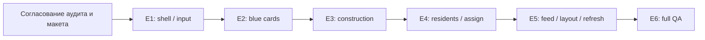

# VillageSim — план внедрения нового UI

## 1. Статус и область плана

Дата: 2026-10-13. Исследованный HEAD: `dc65f4593266fafcf36cfa2fb17a924bae7c127a`. План основан на [UI_DESIGN.md](UI_DESIGN.md) и проверенном коде; технические доказательства, схема состояний, геометрия и альтернативы находятся в [UI_ARCHITECTURE_AUDIT.md](UI_ARCHITECTURE_AUDIT.md).

**Архитектура согласована; E1 и E2 реализованы отдельными заданиями. E3–E6 остаются планом и требуют отдельных заданий.** При отклонении архитектурного варианта актуализировать план, не подменять его молча при coding.

Первая версия включает панели, карточки, ResidentsWindow/AssignmentDialog, существующие building/road/area controls, время, ленту и сохранение F10. Journal/unread, demolition, HP и новые gameplay systems исключены. В Info есть только видимая неактивная «Демонтировать» без callback/подтверждения.

## 2. Зависимости и checkpoints

| Этап | Результат | Зависимости | Обязательный checkpoint |
|---|---|---|---|
| E1 | Canonical shell, безопасный bootstrap и input coordination | Согласованные A1/A4/A6 аудита | Игра/legacy запускаются, старые действия доступны через новую композицию |
| E2 | Синяя панель и специализированные карточки | E1 | Compact/expanded/day/tabs, реальные данные и lifecycle |
| E3 | Зелёная панель, каталог и последовательный placement | E1–E2, согласованный A3 | Validated repeated construction, rotation, cancel и tools |
| E4 | Универсальное окно жителей и диалог назначения/housing | E1–E2, согласованные A2/A5 | Реальные назначения, отказ capacity, сохранение building/card/window |
| E5 | Лента, полнота обновлений и настройка визуального макета | E1–E4 | Два rendered layouts, актуальные данные без per-frame rebuild |
| E6 | Полная интеграционная приёмка и cleanup временных UI связей | E1–E5 | Full suite/analyzer/import/startups/rendered matrix |

E3 и E4 не зависят друг от друга по domain, но последовательность выше уменьшает число одновременно меняющихся input/UI contracts. Каждый этап — согласованное запускаемое состояние; обычно один функциональный коммит на этап, а не десятки микрокоммитов и не единый rewrite. E6 не откладывает безопасность предыдущих этапов: их tests/QA выполняются сразу.

Новые пути ниже — предлагаемый минимальный набор, не существующие files. Не нужно создавать все scripts заранее с пустыми stub-функциями; создавать только используемые компоненты очередного этапа. Одноимённые группы маленьких widgets можно оставить в сцене без собственного скрипта.

## 3. E1 — общая компоновка, bootstrap и ввод

### Цель и зависимости

Подключить один canonical GameUI под CanvasLayer, разместить четыре corner hosts и координатор обычных окон/верхних диалогов. Сохранить реально работающие текущие карточки и construction actions в переходном виде. Ранняя input защита должна предшествовать появлению LineEdit и диалогов.

A1 (hooks/legacy) и A6 (F10/dismiss input) согласованы. A4 уточнён: четыре категории внутри будущей вкладки «Строительство», current stretch и предварительная logical geometry сохранены. Включить только настоящие быстрые функции; Journal/fullscreen не создаются.

### Предполагаемые файлы

Изменяемые:

- `scenes/main_3d.tscn` — только HUD composition; World/Camera/ResidentSelection не переносить.
- `scripts/main.gd` — presentation getters для карточек и малые binding points; default legacy behavior сохранён.
- `scripts/world_3d/main_3d.gd` — canonical UI setup, ссылки на services, override HUD updates и tool adapters.
- `scripts/prototypes/prototype_camera_3d.gd` — optional input predicates с прежними default; не менять pan/zoom math.
- `scripts/debug_panel.gd` — делегирование только competing Esc при canonical UI, F10/paused spawn сохраняются.

Новые:

- `scenes/ui/game_ui.tscn` и `scripts/ui/game_ui.gd` — anchors, UI-only coordinator и window hosts.
- `scripts/ui/ui_input_context.gd` — небольшой focus/pointer/Escape contract; может быть частью GameUI, если отдельный script не нужен.
- `scenes/ui/time_controls.tscn`, `scripts/ui/time_controls.gd` — существующие clock/pause/speed APIs, без новой time model.

### Функции и порядок внедрения

1. Authored UI children готовят widgets до Main._ready; domain references инжектируются из Main/Main3D, без нового population setup.
2. Main default card getters возвращают прежние nodes, Main3D — компоненты Info host. Пока используются старые специализированные scenes, без новых фиктивных карточек.
3. Новый time host получает actual clock/speed/pause controls. Direct callbacks Main и population_label имеют реальные binding targets либо canonical override; не сохранять fake invisible labels ради старого кода.
4. Ненужная canonical telemetry перестаёт форматировать скрытые jobs; legacy HUD остаётся прежним. Функции production/resources не удаляются вместе с Label.
5. Existing Feed размещается в верхнем левом host без изменения generation; порядок новых строк/окончательное оформление завершаются E5.
6. GameUI owns green/window prefs; selection остаётся прежним. Обычные окна/диалог routing готовятся без создания пустых будущих функций.
7. Общий Esc потребляет только одно действие. Main3D tool cancellation и developer Escape вызываются после UI dialog/window priority. F10 не получает видимой кнопки.
8. Text-focus predicate блокирует keyboard polling камеры и gameplay hotkeys; actual MMB/release и wheel остаются прежними там, где UI не использует событие.
9. Panel STOP/wheel boundaries не превращают весь экран в UI shield. Road release/gap observation сохранено.

### Что не изменяется

Main domain creation/order, starter state, GameTime, PlayerCommand, ResidentAssignment, AI dispatcher budget, professions/skills/needs, movement, nav/build grids, haul/recipe/construction execution. Legacy main.tscn и isolated prototype не мигрируются.

### Риски

UI setup вызывается раньше domain; `$HUD/…` оставлен в одном caller; F10 раньше GUI получает Esc; camera polling ignores search; два action обработчика; скрытый old telemetry продолжает нагрузку. Контрмеры — см. аудит §§3.1,4.1,9.

### Автоматические тесты

- Новый `tests/test_ui_shell.gd`: один GameUI, existing selection identity, corner host bounds, no fake day data, initial bind после domain setup.
- Новый `tests/test_ui_input.gd`: верхний dialog→window→tool, одно действие на press, key echo, no LMB/RMB click-through, wheel на краю UI, text focus.
- Existing `test_camera_drag`, `test_debug_panel`, `test_debug_hotkeys`, `test_resident_selection`, `test_main_3d_migration`, legacy `test_ui_cleanup`/`test_player_control`.
- Camera transform/size snapshots до/после открытия/закрытия панели; actual camera movement отдельно проверяется от UI transitions.

### Ручные/rendered проверки

Canonical project launch; время/pause/speeds, selection/cards, обычное размещение, roads/areas, ПКМ команды, F10 и debug spawn на pause. На обоих resolutions предварительно проверить hosts, сохранив истинное physical/logical scale. Legacy direct launch — прежний HUD.

### Критерии приёмки

Игра работоспособна после одного shell-коммита. Domain bootstrap не продублирован. Input gates доступны для следующих этапов; pause не отключает UI. Transitional карточки ещё могут иметь старую внутреннюю структуру, но не исчезают из игры и не перекрывают случайно новые controls. Нет новых warnings/errors, baseline tests проходят.

## 4. E2 — синяя панель, карточки и данные

### Цель и зависимости

Реализовать UI_DESIGN §§4–6 без переписывания domain. Зависит от E1; layout/detail composition A1 согласована.

### Предполагаемые файлы

Изменяемые:

- `scripts/resident_card.gd`, `scripts/building_card.gd` — явные widget bindings/embedded mode, visibility contract, scoped subscriptions и refresh.
- `scripts/world_3d/main_3d.gd` — передача существующих selected-runtime/building-use read providers, без domain ownership.
- UI-specific canonical tests, использовавшие старые node paths. Legacy PackedScene/default paths сохранять, domain assertions не ослаблять.

Новые:

- `scenes/ui/info_panel.tscn`, `scripts/ui/info_panel.gd` — общий shell/header/tab state.
- `scenes/ui/resident_details.tscn`, `scenes/ui/building_details.tscn` — canonical layouts со специализированными существующими scripts.
- `scenes/ui/building_type_preview.tscn`, `scripts/ui/building_type_preview.gd` — реальные BuildingDefinition reads; используется E3.

DaySummary, foldouts и simple labels не обязаны иметь отдельные scripts. Не копировать ResidentData или HaulExecutor logic в новый presenter hierarchy.

### Функции

- Day всегда доступен без selection; compact/expanded, tabs сохраняются при прямой смене объекта и сбрасываются после полного clear.
- Resident: Bio/Work/Relationships; skills/diary foldouts; only existing sparse relationship records; day-filtered diary; no HP.
- Building: Info, Production/Storage по capabilities, UC materials/work, отдельно assigned producers/Porter/visitors, housing и ссылки по именам.
- Disabled demolition Button присутствует без callback и ConfirmationDialog.
- Embedded scripts не show() скрытую вкладку каждый frame; динамические `@onready`/`$…` references переведены на явные bindings, legacy defaults работают.
- Work/Bio не вводят новые picker modes: profession/area/clear используют текущие controls, workplace/home links и действующие ПКМ actions сохраняются. После E4 назначение через выбранное здание и универсальное окно дополняет этот путь; если нужен иной прямой picker из resident-card, это отдельное предложение, не молчаливый новый tool.
- Чтение текущей работы из committed intent/runtime, а не только live profession/workplace; недостоверный idle reason скрыт.

### Неизменяемые системы

Opinions/traits/XP, diary generation/retention, home ownership/fallback, staff capacities, resource amounts/reservations, construction/production progress и formulas. Переназначение не abort действующий safe haul.

### Риски

Две карточки управляют видимостью shell; stale event от старого объекта; day filter удаляет KEY; новая вкладка выводит все neutral residents; `BUILT` автоматически показывает «работает»; physical occupants считаются staff.

### Автоматические тесты

- `tests/test_info_panel.gd`: initial compact, expanded resident→building→resident, compatible tab/fallback, clear/new select, day change, definition preview derived content.
- Actual ResidentData signals обновляют выбранные labels; старый object event не меняет новый content; повторные bind/unbind/free не оставляют callbacks.
- Existing skill/traits/preferences/relationships/social diary suites; `test_building_selection`, `test_housing`, `test_incremental_construction`, `test_builder_waiting`, `test_sawmill`, `test_town_center`.
- Per-resource quantities с reserved_out/in показываются как actual amount/capacity; никаких totals вместо capacities.
- UC→BUILT same object меняет tabs; demolition disabled и ни один removal API не вызван.

### Ручные/rendered проверки

Компактный resident и expanded все три вкладки; двух направленных opinions; diary текущего дня; смена selection со старым record; House/Storage/Town/Sawmill/стройплощадка, imенные links. Открытая карточка во время construction progression и committed reassignment.

### Критерии приёмки

Новая Blue полностью выполняет UI_DESIGN §4–6 и Q1/Q2/Q7/Q9 на доступных данных. Camera transform/zoom не меняется; legacy scenes остаются runnable; node counts стабильны при простом refresh.

## 5. E3 — зелёная панель, каталог и placement

### Цель и зависимости

UI_DESIGN §§3,8 и Q6. Зависит от shell/input E1 и definition preview E2; A3 повторного confirm и A4 расположения roads согласованы.

### Предполагаемые файлы

Изменяемые: `scripts/world_3d/main_3d.gd` (catalog/tool entry points, confirm adapter), `scripts/world_3d/building_placement_3d.gd` (узкое restore orientation/resnap), существующие canonical UI expectations в construction/camera/roads tests. `scripts/building_placement.gd` рекомендуется оставить одноразовым default; менять только если отдельно выбран shared continuous flag.

Новые:

- `scenes/ui/action_panel.tscn`, `scripts/ui/action_panel.gd` — ordered section descriptions и два вида кнопок.
- `scenes/ui/construction_catalog.tscn`, `scripts/ui/construction_catalog.gd` — scroll/GridContainer с image+name tiles и click intent.
- Небольшой UI catalog metadata file по definition ID при необходимости: description/icon/category, без копии стоимости/footprints/capacity.

Legacy `construction_panel.gd` остаётся с default view. Новые изображения должны представлять реально существующие типы, например технические thumbnails authored layouts; художественное направление отдельно согласуется в E5, не выдумываются новые здания.

### Функции

1. TAB/QUICK button registration; toggle активной вкладки, scrolling длинного ряда. В единой вкладке «Строительство» четыре расширяемые категории: «Производство» (хижина лесоруба, каменоломня, хижина собирателя, лесопилка), «Логистика» (склад), «Поселение» (дом, кухня), «Объекты» (Dirt Road). Объекты могут иметь собственный placement adapter; категории не становятся разделами нижнего меню.
2. Семь существующих buildable types, исключён Town Center. Visible names, описания/стоимость в Blue без tooltip dependence.
3. Выбор типа вызывает единый tool bridge: cancel road/area/debug, clear queued input, selection.clear, select definition.
4. После успешного existing confirm повторно активируется та же definition с captured quarter_turns. Проверяется tool generation после callbacks; отмена в placed listener выигрывает, не повторно включается tool.
5. ПКМ/Esc/active tile отменяют mode; другой tile меняет тип. Collapse Construction отменяет placement и возвращает Day; failure validation не создаёт entity.
6. Existing R, snapping, footprints/entrance/runtime blockers и immediate NavigationGrid update сохранены.

### Неизменяемые системы

Building ID generation, UNDER_CONSTRUCTION creation, registration/activation, material sourcing/ledger, BuildGrid vs NavigationGrid, road traversal и cancel_construction lifecycle. Recipes и проверка stock не меняются; нехватка ресурсов не становится placement запретом.

### Риски

Select сбрасывает rotation; buffered click создаёт второй объект; collapse click подтверждает placement; stale placed callback переактивирует отменённый tool; старое road dragging не сброшено; domain и UI запоминают разные definitions.

### Автоматические тесты

- `tests/test_construction_ui.gd`: real clicks tile/other tile/toggle/collapse, one click→one BuildingInstance, selection cleared, preview data from definition, catalog names/images visible.
- Последовательные Home/Sawmill с rotation1/3, correct occupied cells, invalid next footprint без создания; cancellation during placed callback не rearm.
- Upper dialog/window Esc не отменяет tool до своей очереди; green collapse при active tool отменяет только нужный placement без world click.
- Existing `test_build_grid`, `test_construction_3d`, `test_runtime_placement_blockers`, `test_roads`, `test_construction_recipes`, `test_construction_economy`, navigation/connectivity regressions.

### Ручные/rendered проверки

Tile→описание/стоимость→R→две одинаковые стройки; overlap и partial resident overlap; switch Home/Quarry; cancel четырьмя способами; road paint/erase и WorkArea без одновременных tools; настоящая доставка материалов/строительство одного здания.

### Критерии приёмки

UI workflow последовательный, orientation сохраняется, событие не исполняется дважды. Domain validation и resources unchanged; old legacy placement tests сохраняют одноразовый default. Все способы отмены соответствуют спецификации.

## 6. E4 — универсальные жители и назначения

### Цель и зависимости

UI_DESIGN §7/Q3, building management links из §6. Зависит от E1–E2 и A2/A5. Никаких new staffing gameplay rules.

### Предполагаемые файлы

Изменяемые:

- `scripts/settlement_residents_panel.gd` — сохранить control/selection source, заменить одноимённый список на table/search/filter/sort; не второй roster window.
- `scripts/player_control.gd` — только согласованные role/eligibility/housing read-only queries, переиспользующие текущие predicates. Existing setter outcomes и capacity не меняются.
- `scripts/building_card.gd`, `scripts/world_3d/main_3d.gd`, `scripts/ui/game_ui.gd` — все entry points ведут в тот же window coordinator.

Новые:

- `scenes/ui/residents_window.tscn` — authored layout под обновлённый existing script.
- `scenes/ui/assignment_dialog.tscn`, `scripts/ui/assignment_dialog.gd` — upper-layer dialog с captured IDs/context.
- Optional small `scripts/ui/residents_list_query.gd` только для сортировки/поиска UI projection; не повторяет eligibility и не нужен, если функции помещаются в существующем script.

### Функции

- Все registered residents, три columns, name search, current/available profession, work assignment filter, name/age/employment sort и reverse.
- WorkArea учитывается как место; Builder/world-work не объявляется недопустимым из-за пустого workplace.
- У роли нет новых qualifications. Read-only пригодность не зависит от capacity конкретного selected building и не вызывает assign_profession.
- При building selection row открывает dialog только применимых roles; full/UC/already assigned остаются видимыми disabled с readable reason.
- House предлагает housing action, не profession; actual API recheck перед выполнением.
- Success closes dialog только; window+building+blue остаются, counts/rows обновлены; refusal сохраняет старое назначение.
- Cancel closes dialog только; stale context policy из A2, no silent retarget.
- Открытие из green/TC/assign-worker buttons — одна window instance с preset filters, не отдельный selection mode.

### Неизменяемые системы

ResidentData relationship truth/revision, `_assign` atomicity, porter/production capacities, stable-ID normalization, explicit own-endpoint logistics, committed hauling, professions restrictions, housing capacity/fallback, skills и WorkArea semantics.

### Риски

Roster фильтруется по target vacancy; idle путается с unassigned; UI сперва мутирует profession; dialog сохранён от старого building; temporary context удерживает freed entity; assignment signals вызывают слишком много table rebuild.

### Автоматические тесты

- `tests/test_residents_window.gd`: registered inside/sleeping/working residents, поиск, все sort directions/stable ties, WorkArea, unassigned Porter, no capacity filter, one window instance.
- `tests/test_assignment_dialog.gd`: real Sawmill Sawyer/Porter, Gatherer4+Porter1, Home housing, Home0Porter, UC disabled roles; enum/catalog without чужих профессий.
- Query тест фиксирует неизменность profession/location/area/revision после фильтрации; no signals/reservation/path queries.
- Recheck: окно открыто→место занято→pressed; return false, previous assignment и cargo invariant; выбранное здание сохранено.
- Change building/remove resident/stale dialog; cancel onlydialog; success updates counts/rows без close window.
- Existing `test_porter_staffing`, `test_porter_workplaces`, `test_porter_workplace_3d`, `test_player_control`, `test_resident_assignments`, `test_housing`, FREE/BUILDING forestry/mining, self-logistics и food/outdoor regressions.

### Ручные/rendered проверки

Green→Residents; TC→Residents; Sawmill Info→assign production/Porter; third Porter refusal; смена selected building на карте; House→заселение; no-target row→resident card; active haul→reassign, observe old delivery и следующий job. Фильтры и длинные имена на обоих resolutions.

### Критерии приёмки

Полный сценарий §7 работает через настоящие PC/housing. No capacity bypass, double assignment, hidden residents, second selection или loss of old job. Строки остаются актуальными при roster/assignment changes и на pause.

## 7. E5 — лента, обновления и оформление

### Цель и зависимости

Завершить SocialFeed presentation, проверить все live read paths и настроить утверждённую геометрию/читабельность. Зависит от E1–E4; не новая gameplay phase.

### Предполагаемые файлы

Изменяемые: `scripts/social_feed.gd` (canonical newest-first/layout options при legacy defaults), GameUI/TimeControls/InfoPanel/card/window/catalog scripts и scenes, при необходимости Main presentation factory для Feed. F10 debug functionality не менять. `project.godot` не требует смены stretch: текущая measured geometry используется; любое другое решение — отдельное согласование.

Новые: один UI Theme resource и UI thumbnails для имеющихся types, если утверждены; не новые gameplay assets/ресурсы. No JournalWindow, event history service, notification read registry или health system.

### Функции

- Existing feed texts выводятся сверху новыми первыми, прежние Timer/lifetime/limit сохраняются на переносе. Новые уведомления без источника не создаются.
- Event/dirty updates по таблице аудита §10, coalesced minute read после domain listeners; bounded visible poll только silent values, no full per-frame rebuild.
- Diary отображает current day, skill levels derived, storage actual amounts независимо от reserve, visitors separate.
- Настройка fonts/wrapping/scroll, видимости names/cost/reasons, visual distinction TAB/QUICK и green/blue.
- Ordinary windows fixed in logical units, same geometry при collapse/expand Blue. Рendered проверяет фактический stretch 1.5/1.25, а не только CLI window dimensions.
- F10 сохраняется отдельно, without visible button; nav debug/WorkArea confirm не теряются за новым UI.

### Неизменяемые системы

SocialEvent chances/partner selection/RNG/narrative/diary, GameTime/needs/production/XP, per-resource ledger и task priorities. Нет UI-индуцированного поиска маршрутов или переоценки работы.

### Риски

SocialFeed implicit order поменял gameplay event order; timer выбран game-time вместо existing real-time; скрытые карточки обновляются; poll раскачивает table sorts; logical units приняты за screen pixels; font minimum расширяет окно вопреки fixed sizes.

### Автоматические тесты

- `tests/test_ui_updates.gd`: bind/switch/free, node counts, closed windows не сканируют roster периодически, minute coalescing при x20/debug advance.
- Feed порядок newest-first, expiration/limit прежние, no changes to incoming event payload; existing social_event_feed/social_events.
- `tests/test_ui_layout.gd`: rect bounds/intersections при обоих window sizes с actual canvas scale; initial Day и allcards; collapse Blue не меняет Residents rect/camera.
- Actual wheel tables top/bottom, search text W/A/S/D/стрелки/цифры/Space/R/Enter не запускает world controls; focus release восстанавливает прежний control.
- Source/skill/diary/relationship identity сохранены, zero accidental PC assignments при обновлениях.

### Ручные/rendered проверки

Скриншоты на 1920×1080 и 1600×900: empty Day, compact/expanded resident, Info/Production/Storage/UC, residents+expandedblue, active dialog/disabled reasons, construction tiles/ghost и F10. Проверить visually long Russian labels, ряд из многих реально зарегистрированных UI-секций в тесте (не добавлять будущие кнопки в игру), scrolling, no tooltip-only info. Новый layout может быть проверен таким UI fixture без фиктивных gameplay entities; gameplay proof отдельно real world.

### Критерии приёмки

Показанные данные достоверны, новые строки сверху, новые warnings/errors отсутствуют. Окна не перекрывают Blue, их размеры не меняются при раскрытии. Нет camera displacement от UI и no per-frame rebuilding. Геометрия и читаемость подтверждены rendered, а не только headless.

## 8. E6 — интеграционная приёмка первой версии

### Цель и зависимости

Закрыть UI_DESIGN §15 по работающей игре, удалить только переходные UI bindings предыдущих этапов, проверить независимость мира и UI. E1–E5 завершены; нет реализации отложенных функций.

### Предполагаемые файлы

Изменяемые: только завершённые UI scripts/scenes/tests и документирование результата. Main/legacy compatibility hooks не удалять как «лишние» без проверки consumers. Новые большие UI-компоненты не нужны.

Новые tests при необходимости: `tests/test_ui_integration.gd` для объединённого canonical сценария и capture runner; small helper для реального input/capture reuse вместо synthetic framework. Artifacts/logs/screenshots outside repo.

### Функции/checks

- Проверить сохранение всех player flows после каждого перехода green/blue/windows/dialog.
- Отсутствие второго selection, дублирующих жителей/зданий/personnel state и tool activation.
- Карточки верно показывают actual committed work после reassign и UC→BUILT.
- Временно отключённые old canonical telemetry handlers больше не имеют скрытых heavyweight consumers; runtime services продолжают тикать.
- Complete baseline/current diff review: recipes/constants/resources unchanged; no auto-demo UI.

### Неизменяемые системы

Все gameplay systems перечисленные в UI_DESIGN; legacy presentation testability и historical prototype. Завершение UI не разрешает удаление старого Main/2D scripts.

### Риски

Tests переписаны под новую разметку и перестали проверять реальный domain; cleanup удалил важную callback; headless green ошибочно выдан за rendered acceptance; разные baseline speeds/time сравниваются некорректно.

### Автоматические проверки

1. Все existing и new `test_*.gd` отдельными процессами; реальные exit codes и counts, SCRIPT ERROR не маскируется timeout.
2. Targeted UI/input/camera/assign/placement/F10 + full suite; ни один старый gameplay тест не отключён для зелёного результата.
3. Analyzer всех scripts; отдельно старые и новые diagnostics. Известны 4 прежних warnings: building_locations_3d:86 INCOMPATIBLE_TERNARY, test_resource_handling:85/161/176 CONFUSABLE_LOCAL_DECLARATION. Если сохраняются, wrapper exit1 сообщить честно.
4. Godot import, canonical F5-equivalent, direct main_3d, direct legacy и оставшийся prototype headless startup.
5. `git diff --check`, focused staged files, clean status после commits; screenshots/raw results outside Git.

### Ручные/rendered проверки

На двух resolutions: camera WASD/MMB/wheel, actual selection/cards; житель↔здание без смены раскрытия; clear/newselect compact; one quickwindow/dialog Esc priority; real multi-role assignment и capacity refusal; safe old haul finishes after reassign; real EAT outside/Kitchen, TALK_TO/social/diary; roads/WorkArea/FREE and BUILDING work; repeated build + two builders + completed BuildingCard; F10 spawn/time на pause без новой видимой кнопки.

Дополнительно открыть/закрыть/переключить cards и ResidentsWindow 100 раз; проверить orphan/callback counts. С 30 и 100 настоящими зарегистрированными жителями на x1/x20 измерить UI refresh/node allocations, отдельно от domain/nav baseline; не обещать устранение прежних logistics stalls. Не суммировать nested timings и не смешивать headless/rendered performance.

### Критерии приёмки

UI_DESIGN §15 покрыт матрицей evidence; full/targeted suites зелёные, новых analyzer/runtime warnings/errors нет, code/review не выявил gameplay changes. Rendered обеих resolutions с screenshots обязательны. Если часть проверки недоступна, отметить её как непроведённую, не PASS. Только после этого первая версия UI считается реализованной.

## 9. Общая матрица приёмки и evidence

| Требование UI_DESIGN | Этапы | Обязательное доказательство |
|---|---|---|
| §2 четыре области, камера, независимость | E1/E5/E6 | Real rects+camera snapshots и два renders |
| §3 TAB/QUICK/scroll | E3/E5 | Registry count/toggle tests + visual distinction |
| §4 day/compact/expanded/tabs/type | E2/E3 | Transitions через real selection/placement |
| §5 resident data/work/relations/diary | E2/E5 | Actual domain changes, sparse records, current-day filter |
| §6 building info/production/storage/UC | E2/E5/E6 | Real resource ledger/reserves и completion lifecycle |
| Q1/Q2 disabled demo/no HP | E2/E6 | Button disabled/no callback, no HP field/data mutation |
| §7 residents/filter/dialog/home | E4 | Real PC/housing, no mutate probe, full-place refusal |
| §8 construction/Q6 | E3/E6 | Actual two placements, same orientation, invalid/cancel/tool modes |
| §9 windows/fullscreen future contract | E1/E4/E6 | One ordinary window, upper dialog, prefs unchanged; no empty fullscreen |
| §10 messages/diary/Q4 | E5 | Existing event payload, feed ordering/expiration, no journal button |
| §11 clock/F10 | E1/E5/E6 | GameTime APIs/paused F10 actual input |
| Q5 two sizes | E5/E6 | PNG+physical/logical/stretch metadata |
| Q7 selection memory | E2/E6 | Direct switch preserves, clear resets |
| Q8 Esc/click/wheel/search | E1/E3/E4/E6 | Actual root.push_input, gameplay counters unchanged |
| Q9 no invented data | E2/E5/E6 | Capability-hidden unavailable fields, no idle/HP/family fiction |

Использовать `root.push_input(event,true)` с настоящими press/release/motion и ожиданием GUI/process/physics frames. Direct `.pressed.emit()` подходит для малого delegation test, но не подтверждает click-through, focus или cursor geometry. Helpers не должны bypass actual PlayerControl capacity, placement validator или HaulExecutor. Допустимы spy Callables для доказательства «не был вызван API», но final workflow проверяется на canonical domain.

Для Camera3D polling отдельно обеспечить реальное pressed/released состояние Input, например через `Input.parse_input_event`, и выполнить process frame с focused LineEdit; проверить также освобождение клавиш в cleanup. Один вызов camera.pan или доставка key только GUI не доказывает блокировку глобального polling. Это предлагаемые tests, не новые camera tests в текущем аудите.

UI-specific legacy expectations сохраняются для legacy, canonical expectations обновляются вместе с согласованным UX. Например, старый assertion «confirm выключает mode» остаётся в base/legacy test, а новый canonical test требует повтор. Assert о ресурсах/slot cleanup/rotation footprint не удаляется.

Не путать `tests/behavior_test_setup.gd` (настоящая legacy main.tscn) с `tests/legacy_starter_3d.gd` (main_3d с историческим стартовым layout). Последний всё равно использует canonical UI и требует актуальных UX-ожиданий, сохраняя исторический domain setup.

Скриншотами должны сопровождаться реальные IDs/state/time и viewport metadata, без фиктивных значений для заполнения. Rect assertions — дополнение к visual review, не замена.

## 10. Отдельные будущие задачи вне первой версии

| Задача | Почему отдельно | Что сейчас запрещено |
|---|---|---|
| Общий журнал/unread | Нужны настоящий history source, identity, object links и retention contract | Journal button/фиктивные events/read flags |
| Полный демонтаж | Требует целостного world/domain cleanup и отдельно согласованных ограничений | Partial cancel/logistics unregister под кнопкой, material refund |
| Здоровье/HP | Нет domain model, нужен gameplay design | HP в ResidentData, фиктивное 100/100 |
| Семья/родословная/погода | Отдельные механики | Placeholders или вывод семьи из opinion |
| Производственные policy controls | Import/export/min stocks/limits не согласованы как editable gameplay | UI settings, меняющие нынешние policies |
| Small viewport / пользовательский UI scale | Нужна фактическая читаемость и отдельная layout policy ниже предлагаемого minimum | Сдвиг/zoom камеры ради UI, нарушение fixed window/blue separation |

## 11. Решения перед началом реализации

A1–A3 и A5–A6 согласованы: specialized-card embedding с legacy defaults; stale dialog close; canonical repeated-confirm adapter; small read-only queries; F10 и dismissal input policy. A4 уточнён заданием E1: предварительная logical geometry с текущим stretch и четыре категории внутри Construction (см. §5). Каталог и его категории ещё не реализованы. Это не повторный выбор Q1–Q9; dependencies/callers/evidence перечислены выше.

Утверждение отдельных этапов не разрешает автоматически соседний этап или будущие gameplay mechanics. Каждый implementation task должен ссылаться на UI_DESIGN, этот план и утверждённые альтернативы, указывать expected files и acceptance. Если реализация выявит дополнительный domain redesign, остановиться до такого redesign.

Отдельное статическое замечание аудита о Shift+8 без Kitchen не превращается в разрешённый UI bugfix: подтвердить и исправить отдельным согласованным заданием, не менять debug gameplay actions в E1 под видом input coordination.

## 12. Что проверено в текущем аудите

Прочитан актуальный source, разобраны UI bootstrap/input/callers/signals, изучены tests. Десять existing targeted scripts — exit0/801 numbered checks + selection PASS. Headless viewport probe — exit0, measured logical1280×720/stretch1.5/1.25. Ни новая layout scene, ни UI logic не созданы. Full suite/analyzer/import/new rendered QA здесь не запускались; они являются будущими checkpoints, а не результатами исследования.

Документы проверяются на полноту по требованиям, согласованность с UI_DESIGN, корректность source references и scope; `git diff --check` обязателен. Коммит этого аудита содержит только UI_ARCHITECTURE_AUDIT.md и UI_IMPLEMENTATION_PLAN.md. Это исторические результаты аудита до согласования. Последующее согласование и выполненный checkpoint E1 описаны в §§11,13.

## 13. Checkpoint E1

Реализован shell, реальный блок времени, перенос существующей ленты, presentation hooks и общий input context. Существующие карточки/список/строительные кнопки/дороги/области/F10 сохранены. Ширина ActionsAnchor ограничивается свободной полосой слева от карточки; старый ряд кнопок прокручивается. Старые карточки остаются длинными, их compact/expanded и day state относятся к E2. Состояние выбора принадлежит ResidentSelection; состояние tools — Main3D и его существующим инструментам.

Новые `test_ui_shell` и `test_ui_input` проверяют bootstrap, реальные services, transitions, Esc, pause/speeds, mouse boundaries, scroll, focus/polling, F10 paused input. Existing tests используют card getters вместо прежних canonical NodePath. Rendered checkpoint фиксирует два разрешения, stretch и actual Control rects. Подробные результаты/скриншоты находятся вне Git в `C:/Users/SW/Documents/Codex/outputs/ui-e1-shell/REPORT.md`.

E2–E6 не начинались. Collapse-cancel/repeat placement, синяя day-card, универсальный roster/assignment dialog и final feed order остаются в назначенных этапах.

## 14. Checkpoint E2

Canonical InfoPanel имеет DaySummary, ResidentDetails, BuildingDetails и отдельный рабочий BuildingTypePreview из Definition (без создания экземпляра). Панель владеет только expansion/tab state; ResidentSelection — единственный selected object. Прямой переход сохраняет раскрытие и совместимую вкладку; clear возвращает compact Day. Геометрия: 320×52 / 320×152 / 320×568 logical units, нижний правый край, длинные детали в ScrollContainer. Preview пока вызывается отдельно; placement/catalog/repeat wiring — E3.

Существующие resident_card/building_card scripts используют embedded mode и явные unique widget bindings в новых canonical scenes; default legacy paths/scenes сохранены. Общие карточки переиспользуют реальные actions, форматирование и scoped subscriptions. Per-frame refresh сохранён для legacy, canonical fallback обновляет scalar/task fields не чаще 4 Hz, списки/tabs пересоздаются только при изменении их содержимого. Need/skills/traits/preferences/diary/resources/construction/assignment/slot signals обновляют существующие значения.

Resident tabs: Био / Работа / Отношения, foldouts diary текущего дня и skills, только существующие направленные relationship records с разрешением ID при клике. Home clearing, profession, work area creation/reuse/clearing и assignment cancellation используют прежние APIs. Work показывает captured активную доставку независимо от нового назначения.

Building Info разделяет назначенных producers/Porter/жильцов и временные occupied slots; имена интерактивны, освобождение назначения повторно проверяет текущую принадлежность. Disabled «Демонтировать» не имеет callback. Production показывает реальные recipe/input/output buffers и progress; natural-work progress берётся из captured controller/tree/rock context read provider, без вызова selection/path APIs. Storage только у полноценных storage types, actual amount/capacity каждого ресурса без вычитания reservations. UC→BUILT обновляет вкладки того же объекта по construction_changed.

Подробные автоматические/rendered результаты и ограничения: `C:/Users/SW/Documents/Codex/outputs/ui-e2-info-panel/REPORT.md`. E3–E6 не начинались.

## 15. Checkpoint E3

Implemented canonical ActionPanel + ConstructionCatalog with ordered TAB and
QUICK_WINDOW registration, horizontally scrollable menu, internal category row and
vertical tile scroll. Four categories follow approved A4: Production (Lumberjack,
Quarry, Gatherer, Sawmill), Logistics (Storage), Settlement (Home, Kitchen), Objects
(Dirt Road). Real Definitions supply all construction/capacity data; UI-only purpose
text and simple SVG icons remain presentation assets. No Town Center catalogue entry.

Canonical Main3D uses approved A3: one base confirm, captured definition/rotation,
generation checks after placed callbacks, guarded rearm and existing resnap/validators.
Invalid positions keep the tool; cancelled/replaced callbacks win. All four rotations
persist between placements. Entity selection is cleared on building-tile selection;
preview remains until cancellation/replacement. Legacy ConstructionPanel and base
one-shot API are preserved. Opening Residents does not cancel placement; collapsing
Construction cancels its building/road tool, without cancelling unrelated Area/F10.

Green geometry is 720×200 expanded / 720×52 collapsed logical units, 12-unit margins;
Blue E2 geometry and viewport/stretch are unchanged. Existing Residents window remains
the transitional quick window; E4 replaces it separately. Automated tests cover catalogue,
input/callback generations, rotations and tool transitions. Rendered QA includes both
target resolutions, real GUI clicks/rays and actual Ground delivery/Builder completion.
Detailed results and screenshots: C:/Users/SW/Documents/Codex/outputs/ui-e3-construction/REPORT.md.
E4–E6 have not started; future journal and demolition remain out of scope.

## 16. Checkpoint E4

Реализованы ResidentsWindow/AssignmentDialog. Существующий SettlementResidentsPanel
теперь использует Tree с ID metadata, поиском без регистра, независимыми фильтрами
current/eligible profession и наличия назначения, сортировкой name/age/assignment
с reverse и stable-ID tie. Default имя; role preset задаёт eligibility и пустые
назначения первыми. Target capacity никогда не фильтрует население.

Green, Town Center и реальные production/Porter/housing buttons BuildingCard ведут
в один экземпляр окна. Row без selected building выбирает resident; с building
открывает верхний dialog, сохраняет Blue/building и окно. Смена/удаление context
закрывает dialog. Applicable роли читаются из PC; UC/full/already assigned остаются
disabled с видимыми причинами. Assignment/home changes выполняют существующие API
с повторной проверкой; committed hauling сохраняется.

Read queries и housing/eligibility predicates добавлены в PC без изменения правил.
Сигналы обновляют затронутые TreeItems, reorder/filter объединяются; hidden window
не делает постоянных population scans. Scoped connections отключаются при exit;
window подключается к PC после coordinator reparent. No second population/selection.

Rendered QA использует обе целевые resolution, настоящие GUI press/release, PopupMenu
selection, Unicode input, крупный реестр Debug spawn и реальные PC assignments.
Геометрия: roster 680×400, dialog 440×260; Blue не перекрывается и камера не меняется.
Исправлен UI-only stale housing count через home_changed; housing rules unchanged.
Подробные проверки, screenshots и ограничения:
C:/Users/SW/Documents/Codex/outputs/ui-e4-residents/REPORT.md.
E5/E6 и будущие журнал/демонтаж/HP не начинались.

## Фактический checkpoint E5 (2026-10-14)

Общая Theme, canonical newest-first passive SocialFeed и visible-only read
fallback реализованы. Срок жизни/лимит/источники социальных сообщений сохранены.
Окно использует прежние TreeItems, dirty/coalesced updates и существующий реестр;
silent name/age/workplace labels проверяются не чаще одного раза в секунду.
Карточки/диалог используют существующие события и bounded 0.25-second fallback.
Минутные обновления canonical time display coalesced после domain callbacks.

Rendered layout уточнил compact Blue до 320×208 logical units, чтобы длинное
имя не скрывало остальные обязательные сведения; особо длинное содержимое
прокручивается. Expanded Blue 320×568, ResidentsWindow 680×400 и dialog 440×260
сохранены. Viewport/stretch/камера не менялись. Реальные GUI проверки выполнены
на 1920×1080 и 1600×900; подробные результаты и ограничения находятся вне Git
в `C:/Users/SW/Documents/Codex/outputs/ui-e5-polish/REPORT.md`.

E6 не начат. Журнал, уведомления, демонтаж, HP и новые игровые механики не входят
в реализованный этап.
